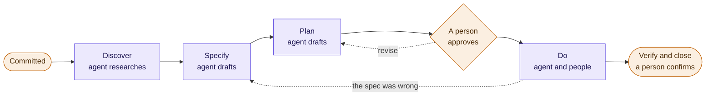

# AKOS — AI as a member of the team

*Agentic Knowledge Operating System*

AI agents are getting good. Most teams still use them on the side: one person, one chat
window, outside the way the team works. So the work where an agent would add the most never
reaches one.

That is not a model problem; it is a tools problem. A team's tools were built for people to
click through: trackers only a person updates, spreadsheets with logic nobody wrote down,
procedures that live in someone's head. An agent cannot safely work in them.

AKOS redesigns those tools so that it can. Each has one source of truth, a documented
structure, rules it keeps, and a skill an agent uses to operate it. With that in place, an
agent is another member of the team: it has a job, it works in the open, and a person decides.

## What the agent does on the team

**Keeps the records.** The backlog, the risks and decisions, the sprint records, the team's
own updates brought in each week. The agent proposes every change; a person confirms it. The
records stay current without anyone chasing them.

**Reports.** The status report, the sprint update, the week ahead: drafted from the same
records in minutes, every figure traceable to its source. The agent drafts; a person rates.

**Supports the work itself.** For each piece of work the team commits to, the agent
researches, writes the spec and the plan in the work's own folder, and, once a person
approves the plan, carries out the steps it can. People do the rest, and review.

**Brings people in.** The project generates its own guide, and the agent walks a new joiner
through their first week.

## What stays with people

Deciding what to build, approving every plan before work starts, confirming every change
before it is recorded, rating every report, and owning the outcome.

## See it

Atlas is a made-up project run on AKOS. Its guides were generated by the tools in this
repository, from Atlas's own files:

- **[The team guide](https://esp1ngard4.github.io/akos/atlas/)**: what a new product manager,
  developer or tester reads on their first day.
- **[The executive overview](https://esp1ngard4.github.io/akos/atlas/executive.html)**: what a
  sponsor or another department receives.

## How a piece of work gets done



Each stop leaves its document in the work's folder (discovery, specification, plan, notes),
so how a result was reached can always be shown. A small fix skips stops; the bigger or less
certain the work, the more it makes.

## A week

Two-week sprints. Planning on the first day: capacity, goals, then the work, with the agent
writing the record. Every day, the team updates its tasks on the board, by hand or by asking
Copilot. On Friday the agent proposes what moved and the product manager confirms it in one
batch. On the last day, the review, the status report and the retro.

## Start

Everything runs on files in your own repository: JSON registers, Markdown, an Excel board.
No service, no account, and nothing to install beyond Python 3.9.

```bash
git clone https://github.com/Esp1ngard4/akos.git
for s in project-definition-manager wbs-manager raid-manager sprint-facilitator \
         weekly-review-facilitator reporting status-board-manager onboarding-guide; do
  python akos/install.py add $s --into <your-repo>
done
```

Commit `.agents/skills/` and `tools.lock.json` together, so everyone who clones gets the same
tools. GitHub Copilot, Codex and Cursor read `.agents/skills/`; for Claude Code add
`--dest .claude/skills`. Then ask your agent, in plain language: *"let's write the project
brief"*, then *"let's run sprint planning"*.

## The tools

| | Tool | What the agent does with it | Skill |
|---|---|---|---|
| TSP.1 | [WBS Register](https://esp1ngard4.github.io/akos/tools/wbs-register.html) | Keeps the backlog: every piece of work, its criteria, estimate and sprint | `wbs-manager` |
| TSP.2 | [RAID Register](https://esp1ngard4.github.io/akos/tools/raid-register.html) | Logs risks, actions, issues and decisions, each with an owner and a date to look again | `raid-manager` |
| TSP.3 | [TSP Register](https://esp1ngard4.github.io/akos/tools/tsp-register.html) | Keeps the inventory of the tools the project runs on | `tsp-manager`, `td-author` |
| TSP.4 | [Tool Installer](https://esp1ngard4.github.io/akos/tools/tool-installer.html) | Nothing: a person installs and updates, and a lock records what was changed | *(none)* |
| TSP.5 | [Artifact Register](https://esp1ngard4.github.io/akos/tools/artifact-register.html) | Knows where every document lives, and checks the filing against the disk | `artifact-register` |
| TSP.6 | [Content System](https://esp1ngard4.github.io/akos/tools/content-system.html) | Turns ideas into a strategy, plans and posts, each written to a contract | five `content-*` skills |
| TSP.7 | [Notebook Manager](https://esp1ngard4.github.io/akos/tools/notebook-manager.html) | Files notes and a diary in plain Markdown | `notebook-capture` |
| TSP.8 | [Sprint Ceremonies](https://esp1ngard4.github.io/akos/tools/sprint-ceremonies.html) | Runs grooming, planning, close-out and the retro with you, and writes each record | `sprint-facilitator`, `sprint-planning-precheck` |
| TSP.9 | [Daily Loop](https://esp1ngard4.github.io/akos/tools/daily-loop.html) | Plans your morning and closes your day, one record per day | `daily-loop-facilitator` |
| TSP.10 | [Reporting](https://esp1ngard4.github.io/akos/tools/reporting.html) | Drafts the status report and the sprint update from the records, for a person to rate | `reporting` |
| TSP.11 | [Weekly Review](https://esp1ngard4.github.io/akos/tools/weekly-review.html) | Checks the week: what falls due beyond the sprint, whether the sprint is on track, the week ahead | `weekly-review-facilitator` |
| TSP.12 | [Action Tracker](https://esp1ngard4.github.io/akos/tools/action-tracker.html) | Keeps the small actions a session agrees, each with its owner | `action-tracker-manager` |
| TSP.13 | [Stakeholder Register](https://esp1ngard4.github.io/akos/tools/stakeholder-register.html) | Knows who hears what and when, and says what is due to whom | `stakeholder-manager` |
| TSP.14 | [Project Definition](https://esp1ngard4.github.io/akos/tools/project-definition.html) | Writes the brief with whoever owns the outcome, and keeps it current | `project-definition-manager` |
| TSP.15 | [Team Status Board](https://esp1ngard4.github.io/akos/tools/team-status-board.html) | Sets up each sprint's board in Excel, and brings the team's updates into the backlog as proposals | `status-board-manager` |
| TSP.16 | [Onboarding](https://esp1ngard4.github.io/akos/tools/onboarding.html) | Generates the project's guide, and walks a new joiner through their first week | `onboarding-guide` |

Each tool's page says what it is for, what it works with and how to install it; [all of them](https://esp1ngard4.github.io/akos/tools/), and [your first hour](https://esp1ngard4.github.io/akos/first-hour.html) setting up Atlas with them. The list generated from the catalogue's own register is the [registry](registry/REGISTRY.md).

## Building on it

Redesigning a tool so an agent can operate it turns out to be mostly making it well governed:
one source of truth, a documented structure, stated rules, and a place in a register of
everything you depend on. That is a method, and it holds for any tool, with or without an
agent. **[Building on AKOS](method/README.md)** covers it: why the unit is the tool rather
than the skill, the seven method pieces, how the catalogue is organised, how an installed copy
stays maintainable, and how it is all tested.

## Where this came from

These conventions were extracted from a personal knowledge and project management
system built up over several years, where the tools grew organically and the
governance was reverse-engineered after the drift had already happened. That's why
every rule has a specific failure attached — they were all paid for.

Nothing from that system is included here. The tools are generic, the examples
invented, and the vocabulary stripped of anything local.

## License

MIT — see [LICENSE](LICENSE). Use, adapt and redistribute freely.
